<picture>
  <source media="(prefers-color-scheme: dark)" srcset="assets/header-dark.svg">
  
</picture>

 

I'm Evan. I build commercial software in Japan and see it all the way through: schema, code, deployment, and the client meeting in between. Most of what I ship is deliberately unglamorous. Accounting integrations that pass Shopify's App Store review, a booking system that can't double-book, an app parents open every morning before school.

Most of that work is closed-source product and client code, so the public repos here are only part of the picture. The rest is below.

 

### Work

**[帳場ラボ · Chouba Lab](https://choubalab.com)** &ensp;<code>in app store review</code> 
A Shopify app that turns orders, refunds and payout fees into itemised journal entries in freee, with the right consumption-tax category on every line. Shipping allocation and OAuth token rotation are handled so nobody keys in bookkeeping by hand. In production since July 2026. 
Remix · Shopify App Bridge · Polaris · Prisma · Fly.io · freee API

**[Sabizu](https://sabizu.com)** &ensp;<code>live</code> 
Booking for one-person shops. Every shop gets its own subdomain and QR code, and customers can book without making an account. Double booking is ruled out by a Postgres exclusion constraint in the database, not by application code. Row-level security is verified on all ten tables. Flat monthly price, no commission. 
Next.js 16 · Supabase · Stripe · Resend · next-intl

**Happy Island** &ensp;<code>live</code> &ensp;[App Store](https://apps.apple.com/jp/app/happy-island/id6760802460?l=en-US) · [Google Play](https://play.google.com/store/apps/details?id=com.happyisland.app) 
Parent and teacher messaging for primary-school families. Native on iOS and Android, plus a web dashboard for staff. Both run on one Supabase backend, and the web side is served from Cloudflare Workers through OpenNext. 
Expo · React Native · Next.js 16 · Supabase · Cloudflare Workers

**[OpenJLPT](https://github.com/evanclan/OpenJLPT)** &ensp;<code>open source</code> 
The JLPT N5–N1 lists, rebuilt properly: 7,811 words, 2,383 kanji and 526 grammar points. 99.7% of words are linked to JMdict, which caught hundreds of wrong readings in the source lists. Each fix is backed by a test. Ships as JSON, CSV, SQLite, Anki, Yomitan, `npm i openjlpt` and `pip install openjlpt`, and is rebuilt monthly and schema-checked in CI. 
TypeScript · SQLite · JSON Schema · GitHub Actions · CC BY-SA 4.0

**[raja-r.com](https://www.raja-r.com)** &ensp;<code>live</code> 
A rebuild of the site for かえる留学, a study-abroad agency, moved from Jimdo to a static Next.js build without losing the search rankings the old site had earned. All 26 legacy URLs redirect in a single hop, and the redirect map is a check that has to pass before deploy. 
Next.js 16 · Vercel · Resend · WordPress (headless)

**Attendance & payroll systems** &ensp;<code>in use at several clients</code> 
RFID and QR check-in, payroll calculation, LINE notifications to guardians, and admin dashboards for Japanese schools and businesses. One of them is [public](https://github.com/evanclan/natsuki-attendance). 
Next.js · Supabase · LINE Messaging API · n8n

**[Guro Ako](https://www.facebook.com/mgakaguro.page/)** &ensp;<code>since 2021</code> 
A content network for Filipino teachers: a 300k-member community, a 200k-subscriber video channel, and the web platform behind them. 
Next.js · Sanity · YouTube Data API

 

### In progress

- **Chouba Lab for Money Forward.** The same journal engine, pointed at Money Forward. The first live webhook posted a real entry to a production ledger, and it now handles Money Forward's refresh-token rotation race.
- **RaJA Global Academy.** A bilingual Japanese/English rebuild of a school's website on Next.js, replacing Jimdo.
- **留学クエスト · Ryuugaku Quest.** A turn-based RPG in Godot 4.7 for Japanese students learning English. Right answers are attacks, and missed words come back through spaced repetition. The zones follow a study-abroad trip: airport, homestay, school, town.
- **Perception.** A research build that captures four screen streams in parallel and compresses each frame to 30–128 KB, so an agent can learn what someone is actually doing at a desktop.

 

### How I work

- **Put invariants in the database.** If two bookings must never overlap, Postgres enforces it, not an `if` in a request handler.
- **A migration should never cost the client their search traffic.** Redirects, canonicals and the sitemap are verified against the live domain before anyone calls it launched.
- **Keep secrets out of git.** I keep one registry of which account owns which project across my three machines, so neither I nor a coding agent deploys to the wrong one. It stores IDs and variable names only, and a check scans for keys before every commit.
- **Make the type system enforce translation.** On [evanserv.com](https://www.evanserv.com), a project without both English and Japanese copy fails to compile.
- **Treat Japanese business rules as the product.** Consumption tax, freee, Money Forward and LINE are where the real work is, not edge cases.

 

### Tools

<b>PRODUCT</b> &ensp;TypeScript · React · Next.js · React Native (Expo) · Remix · Tailwind 
<b>DATA</b> &ensp;PostgreSQL · Supabase (RLS) · Prisma · SQLite · OAuth 2.0 
<b>INFRA</b> &ensp;Vercel · Fly.io · Cloudflare Workers & Tunnel · Netlify · GitHub Actions 
<b>COMMERCE</b> &ensp;Shopify apps · freee · Money Forward · Stripe · LINE Messaging API · Resend 
<b>AI</b> &ensp;Claude · OpenAI · Gemini · MCP servers · n8n · Playwright 
<b>CRAFT</b> &ensp;Godot · After Effects · Premiere Pro · Photoshop · Illustrator

 

### Elsewhere

[evanserv.com](https://www.evanserv.com) &ensp;·&ensp; [LinkedIn](https://www.linkedin.com/in/evanalferez)

I work in English, 日本語, Cebuano and Tagalog. ご相談は日本語でも英語でもお気軽にどうぞ。

 

Updated October 2026. The header is drawn by <a href="scripts/build_header.py"><code>scripts/build_header.py</code></a>.
