<picture><source media="(prefers-color-scheme: dark)" srcset="assets/header-dark.svg"></picture>

 

I'm Evan. I build commercial software in Japan and see it all the way through: schema, code, deployment, and the client meeting in between. Most of what I ship is deliberately unglamorous. Accounting integrations that pass Shopify's App Store review, a booking system that can't double-book, an app parents open every morning before school.

Most of that work is closed-source product and client code, so the public repos here are only part of the picture. The rest is below.

 

<picture><source media="(prefers-color-scheme: dark)" srcset="assets/sections/work-dark.svg"></picture>

<a href="https://choubalab.com"><picture><source media="(prefers-color-scheme: dark)" srcset="assets/cards/chouba-lab-dark.svg"></picture></a><a href="https://sabizu.com"><picture><source media="(prefers-color-scheme: dark)" srcset="assets/cards/sabizu-dark.svg"></picture></a>
<a href="https://apps.apple.com/jp/app/happy-island/id6760802460?l=en-US"><picture><source media="(prefers-color-scheme: dark)" srcset="assets/cards/happy-island-dark.svg"></picture></a><a href="https://github.com/evanclan/OpenJLPT"><picture><source media="(prefers-color-scheme: dark)" srcset="assets/cards/openjlpt-dark.svg"></picture></a>
<a href="https://www.raja-r.com"><picture><source media="(prefers-color-scheme: dark)" srcset="assets/cards/raja-r-dark.svg"></picture></a><a href="https://github.com/evanclan/natsuki-attendance"><picture><source media="(prefers-color-scheme: dark)" srcset="assets/cards/attendance-dark.svg"></picture></a>
<a href="https://www.facebook.com/mgakaguro.page/"><picture><source media="(prefers-color-scheme: dark)" srcset="assets/cards/guro-ako-dark.svg"></picture></a><picture><source media="(prefers-color-scheme: dark)" srcset="assets/cards/ryuugaku-quest-dark.svg"></picture>

 

<picture><source media="(prefers-color-scheme: dark)" srcset="assets/sections/progress-dark.svg"></picture>

- **Chouba Lab for Money Forward.** The same journal engine, pointed at Money Forward. The first live webhook posted a real entry to a production ledger, and it now handles Money Forward's refresh-token rotation race.
- **RaJA Global Academy.** A bilingual Japanese/English rebuild of a school's website on Next.js, replacing Jimdo.
- **Perception.** A research build that captures four screen streams in parallel and compresses each frame to 30–128 KB, so an agent can learn what someone is actually doing at a desktop.

 

<picture><source media="(prefers-color-scheme: dark)" srcset="assets/sections/method-dark.svg"></picture>

- **Put invariants in the database.** If two bookings must never overlap, Postgres enforces it with an exclusion constraint, not an `if` in a request handler.
- **A migration should never cost the client their search traffic.** Redirects, canonicals and the sitemap are verified against the live domain before anyone calls it launched.
- **Keep secrets out of git.** I keep one registry of which account owns which project across my three machines, so neither I nor a coding agent deploys to the wrong one. It stores IDs and variable names only, and a check scans for keys before every commit.
- **Make the type system enforce translation.** On [evanserv.com](https://www.evanserv.com), a project without both English and Japanese copy fails to compile.
- **Treat Japanese business rules as the product.** Consumption tax, freee, Money Forward and LINE are where the real work is, not edge cases.

 

<picture><source media="(prefers-color-scheme: dark)" srcset="assets/sections/stack-dark.svg"></picture>

<picture><source media="(prefers-color-scheme: dark)" srcset="assets/stack-dark.svg"></picture>

 

<picture><source media="(prefers-color-scheme: dark)" srcset="assets/sections/activity-dark.svg"></picture>

<picture><source media="(prefers-color-scheme: dark)" srcset="https://raw.githubusercontent.com/evanclan/evanclan/output/activity-dark.svg"></picture>

 

<picture><source media="(prefers-color-scheme: dark)" srcset="assets/sections/contact-dark.svg"></picture>

[evanserv.com](https://www.evanserv.com) &ensp;·&ensp; [LinkedIn](https://www.linkedin.com/in/evanalferez) &ensp;·&ensp; Happy Island on [App Store](https://apps.apple.com/jp/app/happy-island/id6760802460?l=en-US) and [Google Play](https://play.google.com/store/apps/details?id=com.happyisland.app)

I work in English, 日本語, Cebuano and Tagalog. ご相談は日本語でも英語でもお気軽にどうぞ。

 

Every graphic on this page is drawn by <a href="scripts/draw.py"><code>scripts/draw.py</code></a>. The activity panel is redrawn every morning by GitHub Actions.
